# Screenshots

Every feature, from a demo store of public sites, at 1440 x 900 and twice the pixel density. Made by
`make screenshots` (`CHECK=1` checks the links first, so link health shows); see `web/src/screenshots/capture.mjs`.

## 01. Bookmarks

**01.01** A folder: its link health, where its bookmarks came from, and a picture of each page.

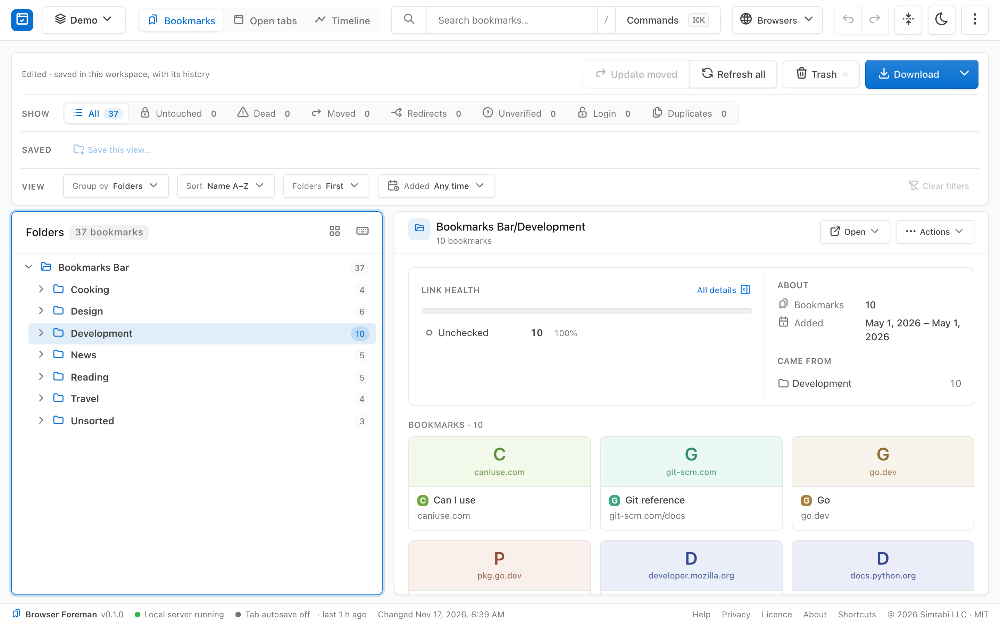

**01.02** The same view in dark mode.

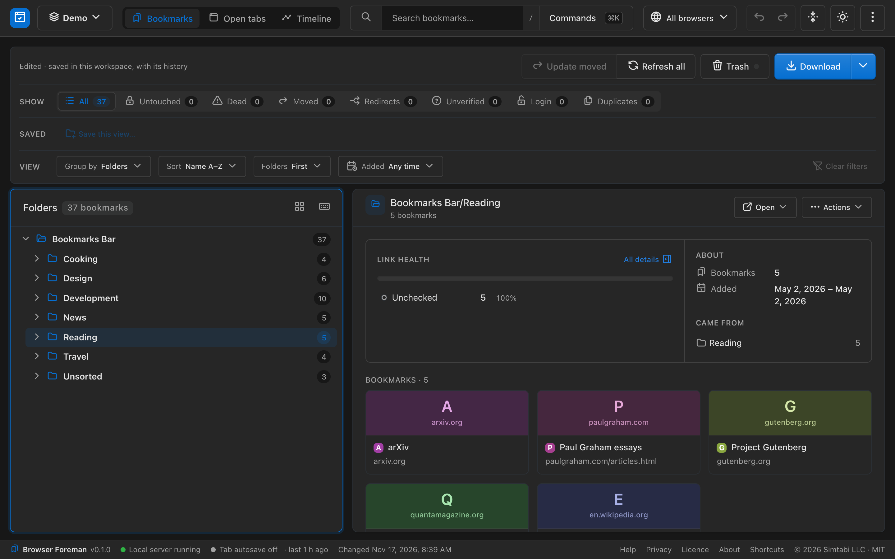

**01.03** Search across titles, addresses, folders, notes and tags as you type.

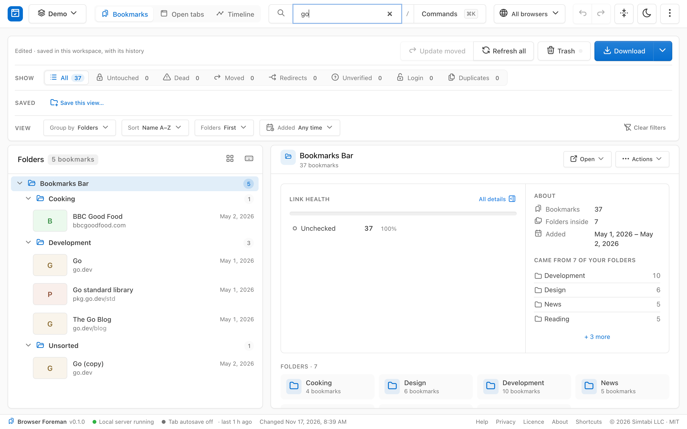

**01.04** Show: only the bookmarks whose page moved, ready to update.

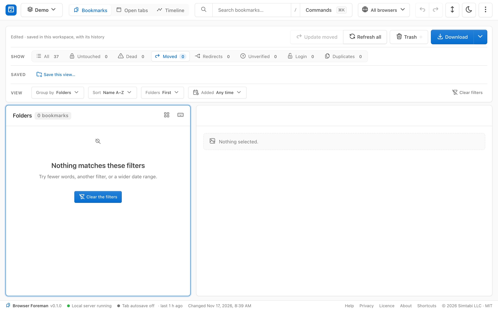

**01.05** The Trash: removed and merged-away bookmarks, each with the reason, ready to put back.

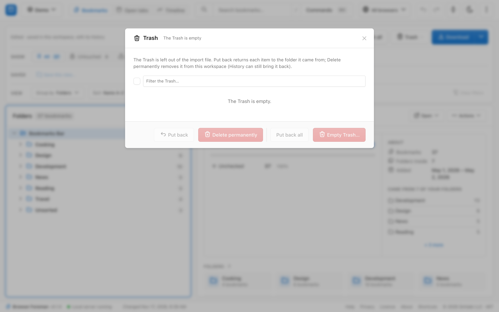

## 02. Tabs

**02.01** Open tabs: windows and tabs from a saved snapshot, to restore after a crash.

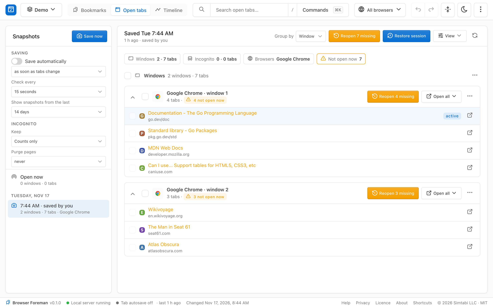

**02.02** The Timeline: every tab snapshot over time.

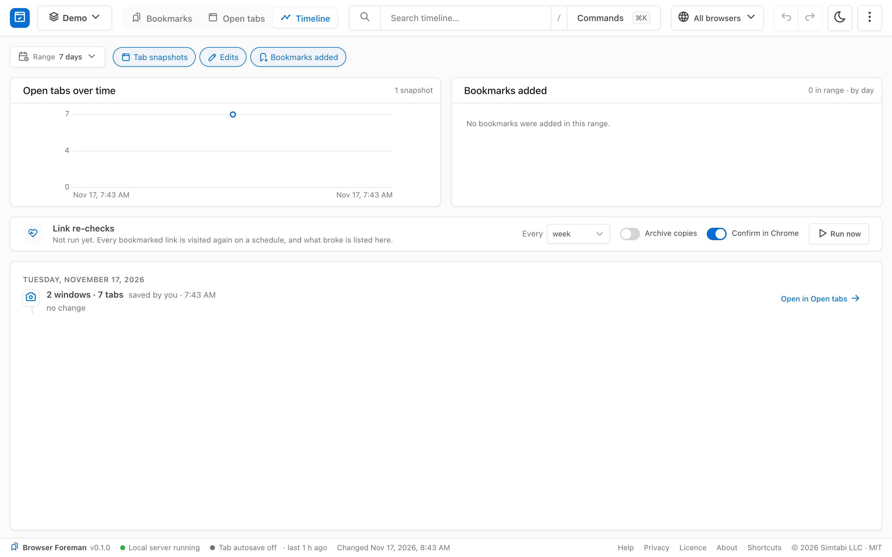

## 03. Workspaces

**03.01** The workspace menu: switch, rename, lock, archive or see the history of a workspace.

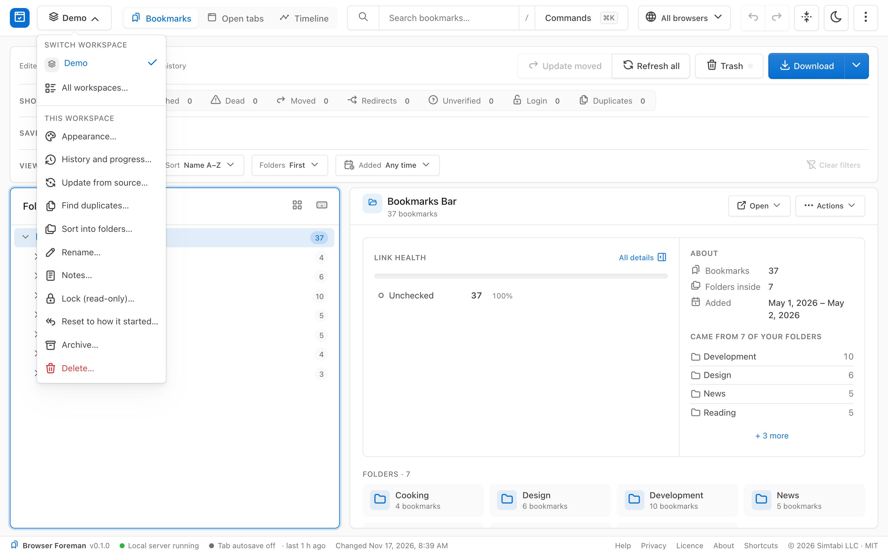

**03.02** Import and export: browser bookmark files in, an import file for every browser out.

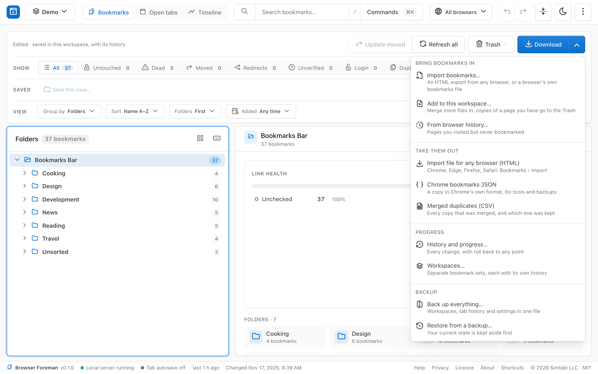

## 04. Browsers

**04.01** Browsers: which open links, which are read for tabs, and their extensions.

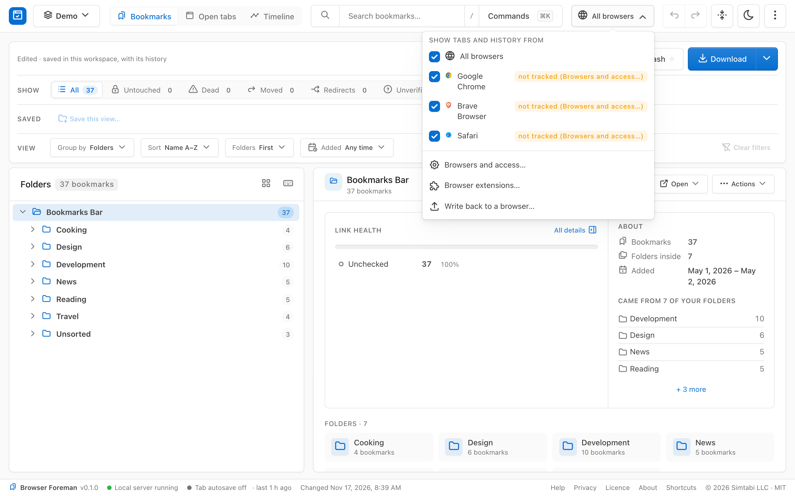

## 05. Settings

**05.01** Settings: the page's own preferences.

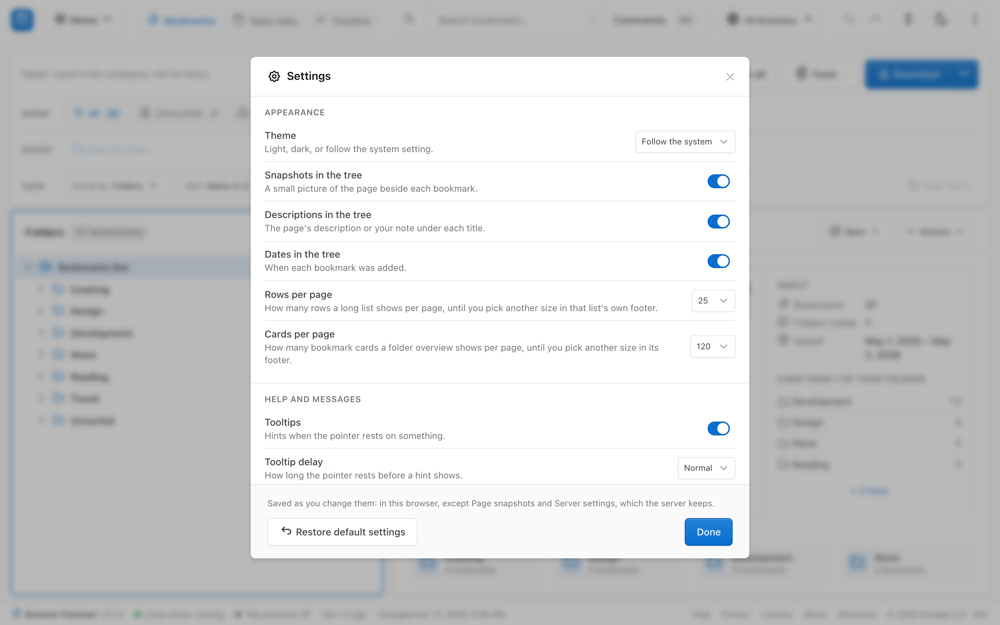

**05.02** Server settings: AI provider, model and keys, written to the config files and .env. Keys are never shown back.

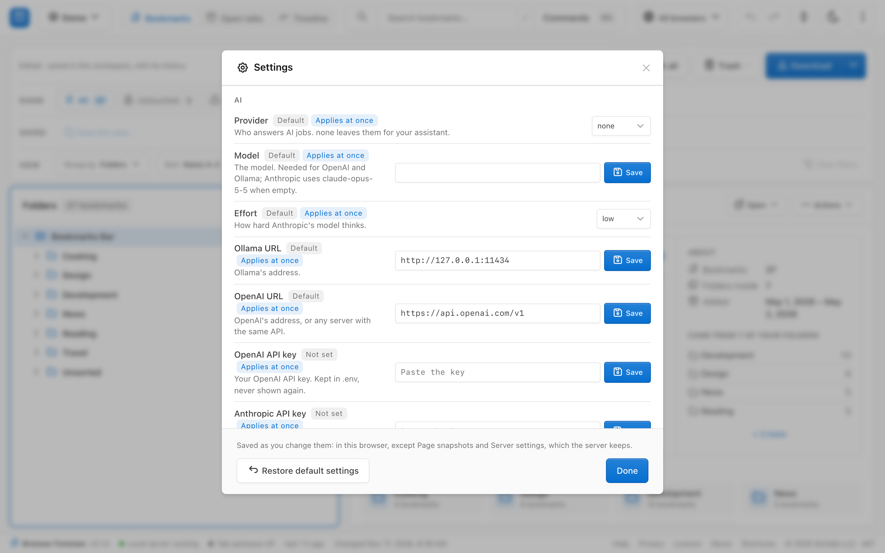

## 06. Commands

**06.01** The command palette: every action, searchable, with its shortcut.

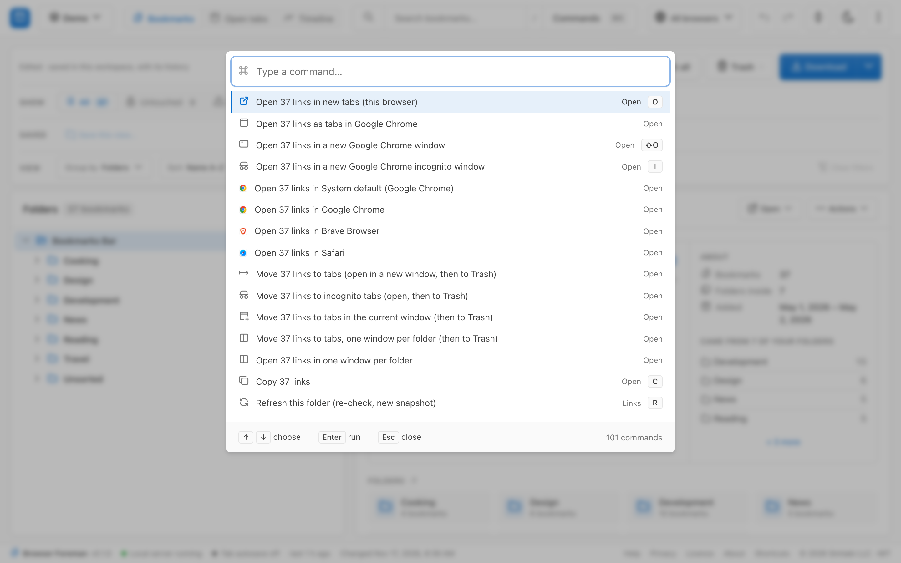

**06.02** Keyboard shortcuts.

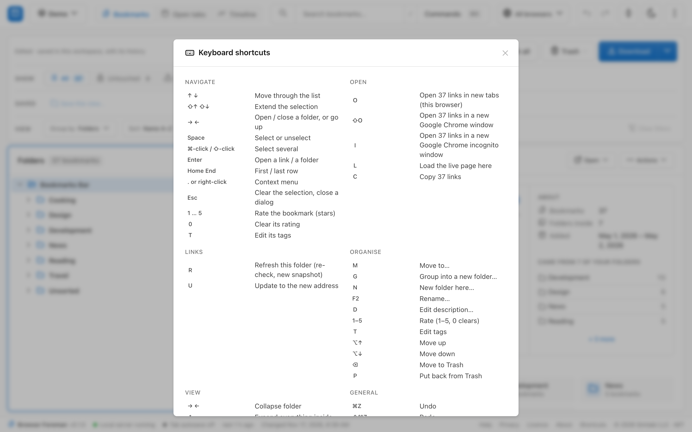

---
[← Docs index](../README.md#documentation)
